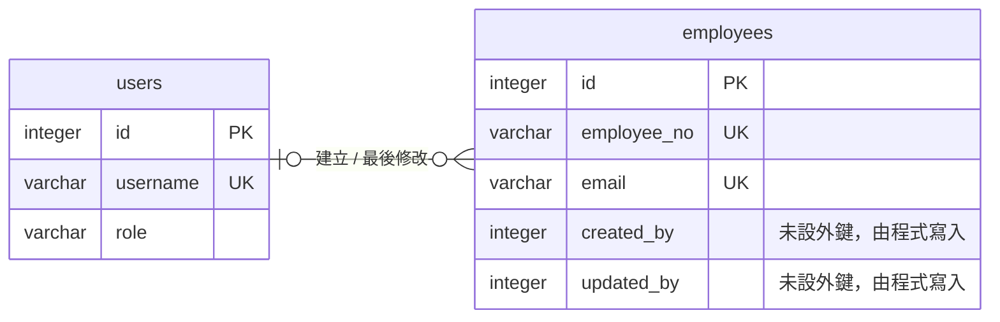

# Nest.js 架構說明

## 模組與責任

依**業務領域**切模組，而不是依技術層。要修改員工功能時，只需要看 `employees/` 一個資料夾。

| 模組 | 責任 | 對外提供 | 依賴 |
|---|---|---|---|
| `AuthModule` | 登入、簽發 JWT、修改自己的密碼、**全域**的認證與授權 | `/auth/*`、兩個 `APP_GUARD` | UsersModule、JwtModule、ThrottlerModule |
| `UsersModule` | 帳號管理、提供帳號資料給登入使用 | `UsersService`（export，資料層不對外）、`/users` | TypeORM |
| `EmployeesModule` | 員工的查詢、新增、修改與業務規則 | `/employees` | TypeORM |
| `DatabaseModule` | 資料庫連線、啟動時執行 migration | — | ConfigService |
| `common/` | 跨模組共用的工具（不是 Nest module） | 錯誤碼定義、錯誤格式、驗證 decorator、DB 錯誤轉譯 | — |

**模組之間沒有循環依賴。** `@RequirePermissions`、`@CurrentUser` 是一般的函式，不屬於任何模組，所以 UsersModule 和 EmployeesModule 使用它們時不需要 import AuthModule。實際的權限檢查由 AuthModule 以 `APP_GUARD` 全域執行。

## 模組內的分層

`employees/` 與 `users/` 都分成三層，呼叫方向固定為 控制層 → 邏輯層 → 資料層。以 `employees/` 為例：

| 分層 | 檔案 | 負責 |
|---|---|---|
| 控制層 | `employees.controller.ts` | 路由、宣告權限、解析參數 |
|  | `dto/` | 欄位格式、資料正規化（trim、轉小寫）、決定哪些欄位可以送入 / 回傳 |
| 邏輯層 | `employees.service.ts` | 流程：查詢現有資料 → 檢查規則 → 寫入；唯一性、樂觀鎖；把資料層的例外轉成業務錯誤碼。**不直接操作資料庫** |
|  | `employee.rules.ts` | 狀態轉換表、日期一致性。**純函式，不依賴 Nest 與資料庫** |
| 資料層 | `employees.repository.ts` | 所有查詢與寫入（TypeORM Repository、Query Builder）；條件式更新；把 DB 的 unique 錯誤轉成 `UniqueConstraintException`（只說明哪個欄位重複，不帶業務錯誤碼） |
|  | `employee.entity.ts` | 資料表結構、DB constraint |

`auth/` 沒有自己的資料表，需要的帳號資料都透過 `UsersService` 取得，所以沒有資料層。`UsersModule` 只 export `UsersService`，其他模組無法繞過邏輯層直接存取帳號資料。

- **資料層獨立**：邏輯層只看得到「取得、新增、更新」這類方法，不需要知道 SQL 怎麼寫；查詢方式改變時只需要修改資料層
- **資料層用型別定義界線，不另外寫轉換**：資料層自己定義需要的欄位（`QueryEmployeesDb`、`AddEmployeeDb`、`UpdateEmployeeDb`，命名方式與 DTO 對應，結尾改為 `Db`），不 import 任何 DTO。TypeScript 依欄位比對型別，邏輯層可以直接傳入 DTO，不需要逐層轉換
- **業務規則抽成純函式**：不用啟動 app、不用 mock 資料庫就能測試，規則也只寫在一個地方
- **Entity 與 Response DTO 分開**：資料表新增內部欄位不會自動出現在 API 回應中；`passwordHash` 不會被回傳

## 橫切關注點

| 關注點 | 實作 |
|---|---|
| 認證 | `JwtAuthGuard`（全域） |
| 授權 | `PermissionsGuard`（全域） |
| 輸入驗證 | 全域 `ValidationPipe`（`whitelist`、`forbidNonWhitelisted`、`transform`） |
| 錯誤處理 | 各層丟出 `AppException.of(ErrorCode.XXX)`，HTTP 狀態碼與預設訊息集中定義在 `ERROR_DEFINITIONS`（`error-codes.ts`）；全域 `HttpExceptionFilter` 統一回應格式 |
| 登入限流 | 兩層：`ThrottlerGuard` 依 IP 限流，只套用在需要驗證密碼的 endpoint；`AuthService` 依帳號計算連續失敗次數並暫時鎖定 |

這些全域設定寫在 `app.setup.ts`，`main.ts` 與 e2e 測試共用，確保測試的行為與正式環境相同。

## 資料庫設計

圖中只列出主鍵、唯一欄位與關聯欄位，完整欄位見下方表格。

**兩張表的關係**

- `users` 是**能登入系統的帳號**，`employees` 是**被管理的員工資料**。兩者是不同的概念：員工不一定有帳號，帳號也不一定是員工，所以沒有一對一的關聯
- 唯一的關聯是**操作紀錄**：`employees.created_by` / `updated_by` 記錄是哪個帳號建立、最後修改了這筆員工資料。一個帳號可以操作多位員工（一對多）
- 這個關聯**沒有在資料庫設定外鍵**，由程式寫入。因為帳號不提供刪除（只能停用），不會出現指向不存在帳號的紀錄

### `users`

| 欄位 | 型別 | 說明 |
|---|---|---|
| id | integer PK | |
| username | varchar(50) UNIQUE | 小寫儲存 |
| password_hash | varchar(100) | bcrypt，不儲存明碼 |
| role | varchar(20) | CHECK IN (`admin`, `readonly`) |
| is_active | boolean | 停用後，已簽發的 token 立即失效 |
| password_changed_at | timestamptz NULL | 修改密碼後，之前簽發的 token 失效 |
| failed_login_count | integer DEFAULT 0 | 連續登入失敗次數；登入成功、鎖定、解鎖時歸零 |
| locked_until | timestamptz NULL | 連續失敗達到上限時，鎖定到這個時間 |
| created_at / updated_at | timestamptz | |

### `employees`

| 欄位 | 型別 | 說明 |
|---|---|---|
| id | integer PK | 系統內部 ID，用在 URL |
| employee_no | varchar(20) UNIQUE | 業務識別碼，不可修改 |
| name | varchar(50) | |
| email | varchar(254) UNIQUE | 小寫儲存 |
| phone | varchar(20) NULL | |
| department | varchar(50) INDEX | |
| job_title | varchar(50) | |
| hire_date | date INDEX | |
| status | varchar(20) INDEX | CHECK IN (`active`, `on_leave`, `resigned`) |
| resignation_date | date NULL | CHECK：離職才能有值，且不可早於到職日 |
| version | integer | 樂觀鎖 |
| created_by / updated_by | integer NULL | 誰建立、誰最後修改 |
| created_at / updated_at | datetime | |

- **Index**：`department`、`status`、`hire_date` 是列表的篩選條件
- **CHECK constraint**：service 已經檢查過的規則，資料庫再擋一次。直接修改資料或程式有 bug 時，資料庫仍會拒絕不合法的資料
- **Migration**：不使用 `synchronize`（可能因為改欄位名稱而刪除資料），啟動時自動執行 migration。e2e 測試會確認 migration 產生的 schema 與 entity 一致

## 命名慣例

遵循 Nest 官方慣例，看檔名就知道檔案是什麼。

| 種類 | 規則 | 例子 |
|---|---|---|
| 檔案 | `名稱.類型.ts`，kebab-case；DTO 一個檔案一個 class；資料層為 `名稱.repository.ts` | `employees.service.ts`、`employees.repository.ts`、`create-employee.dto.ts` |
| 單數 / 複數 | 一筆資料用單數；模組、API 路徑、資料表用複數 | `Employee` / `EmployeesService`、`/employees` |
| DTO | 動作 + 資源 + `Dto`；回應用 `ResponseDto` | `CreateEmployeeDto`、`EmployeeResponseDto` |
| 函式動詞 | `get` / `getMany` 取得（資料層找不到回傳 null）；`is…Exist` 是否存在；`add` / `update` 寫入；`update…If…` 條件式更新，回傳是否成功；`…OrThrow` / `assert…` 不符合就丟例外 | `getById`、`isEmailExist`、`updateIfOtherAdminExists`、`getEntityOrThrow`、`assertEmailAvailable` |
| 資料庫 | snake_case，在 entity 中對應到 camelCase | `hire_date` ↔ `hireDate` |
| 錯誤碼 / 權限 | `資源_狀況` / `資源:動作` | `EMPLOYEE_NOT_FOUND` / `employee:read` |

例外：unique constraint 的名稱是 TypeORM 自動產生的雜湊值。
